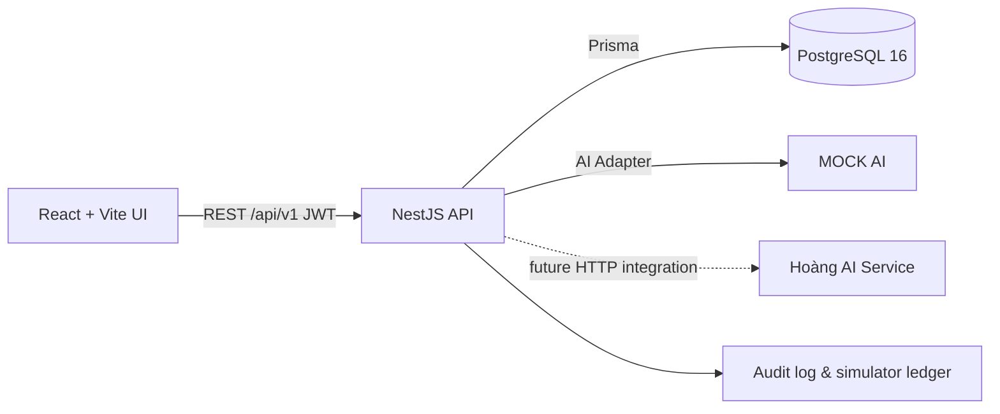
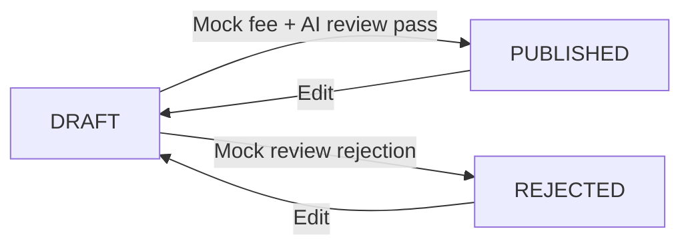
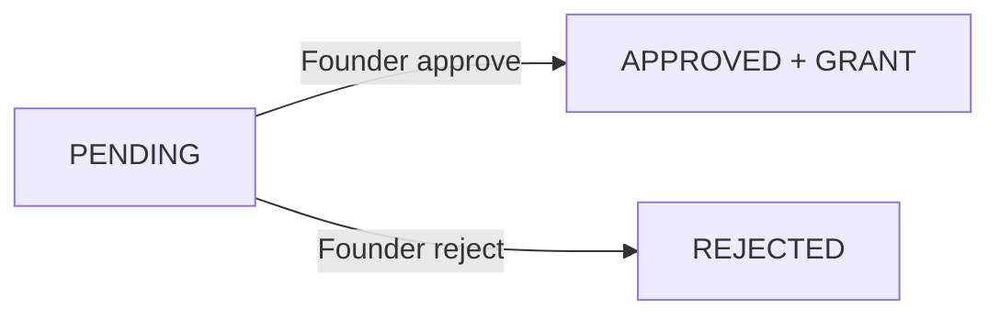
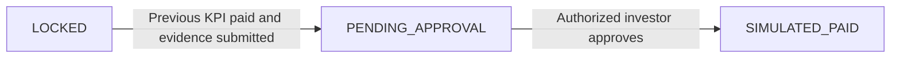

# Architecture and design constraints

## Core bounded contexts

- **Identity**: User, roles (INVESTOR/STARTUP/ADMIN), demo eKYC flag, JWT.
- **Pitch**: only one pitch per startup, draft/publish lifecycle, immutable AI review history, progress quota.
- **Access**: anonymous investor-facing DTO, unique request, startup decision, grant, conflict warning.
- **Deal**: investor-funded simulation, milestones, evidence, release and ledger, 5% fee.
- **Operations**: audit log, localhost demo reset, Swagger contracts.

## State machines

**Blind DTO:** Public API deliberately omits `brandName`, `founderName`, `secret`, `privateDetails`, investor holdings, AI private data and access grants. The frontend cannot unblur what it never received.

**Transaction safety:** A successful milestone release atomically updates milestone state, creates one payout and creates balanced ledger entries. Unique `Payout.milestoneId` prevents duplicate settlement records.

**Risk limitation:** MOCK AI scores and conflict similarity are deterministic demonstration outputs; the backend always enforces access decisions. Zero real deposits, transfers or payments.

**Revision isolation:** editing a pitch invalidates prior access grants and requests in the same database transaction and returns it to DRAFT, forcing AI reassessment. Investors cannot read unpublished revisions even with a stale grant.

**Token reset:** each seeded User has `authVersion`; JWTs contain the version and are rejected after Admin Reset recreates the demo identities.

**Public AI output:** AI HTTP provider results are untrusted; the public narrative is generated on the API server from non-sensitive fields rather than exposing unreviewed model output to the Blind Feed.

**Windows hosting:** NestJS and Vite bind loopback (`127.0.0.1`) for local-only demo; PostgreSQL is exposed only on 127.0.0.1:55432.

## Frontend routes

| Route | Audience |
|---|---|
| `/login` | Demo sign-in |
| `/app` | Role-based overview |
| `/app/discover` | Investor only |
| `/app/pitch` | Startup only |
| `/app/access` | Startup and Investor |
| `/app/deals` | All signed-in roles, deal queries filter participants |
| `/app/audit` | Admin only |

**Routing security:** React role guards are only usability controls. All real access decisions are made on NestJS service methods.
